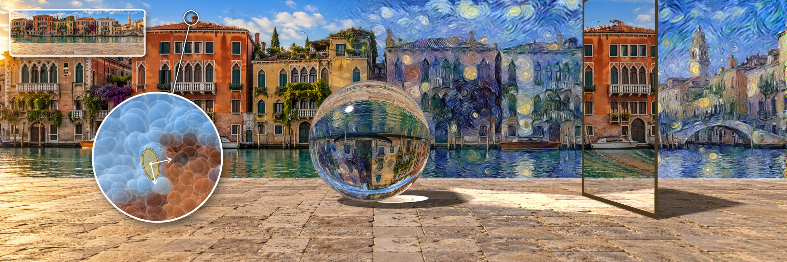
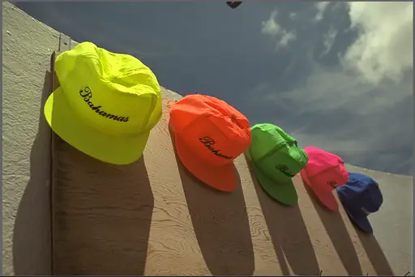
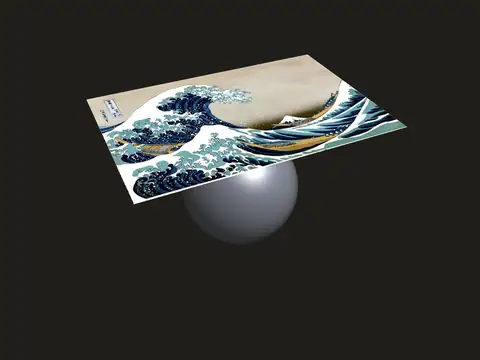
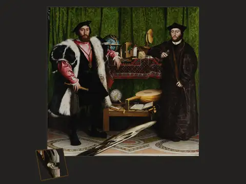
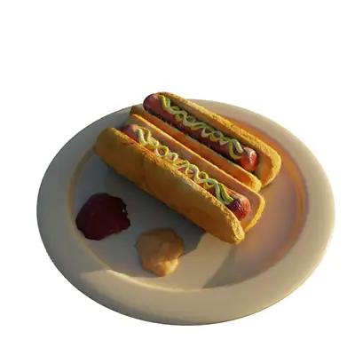

<div align="center">

# FACET: Ray-Traceable Local Implicit Neural Representations for Editable Images

<p>
<a href="https://github.com/rtobiasz">Rafał Tobiasz<sup>1,3</sup></a>,
<a href="https://grzegorzwilczynski.com">Grzegorz Wilczyński<sup>1,3</sup></a>,
<a href="https://scholar.google.com/citations?user=ISOdWukAAAAJ&hl=pl&oi=ao">Mikołaj Zieliński<sup>1,2,4</sup></a>,
<a href="https://scholar.google.com/citations?user=ef2YKtsAAAAJ&hl=pl&oi=sra">Krzysztof Byrski<sup>1</sup></a>,
<a href="https://scholar.google.com/citations?user=3XvUbbMAAAAJ&hl=en">Dominik Belter<sup>2</sup></a>,
<a href="https://scholar.google.com/citations?user=0kp0MbgAAAAJ&hl=en">Przemysław Spurek<sup>1,3</sup></a>
</p>

<p>
<a href="https://en.uj.edu.pl/en"><sup>1</sup>Jagiellonian University</a> &nbsp;
<a href="https://put.poznan.pl/en"><sup>2</sup>Poznań University of Technology</a> &nbsp;
<a href="https://www.ideas.edu.pl/en/"><sup>3</sup>IDEAS Research Institute</a> &nbsp;
<a href="https://ai.uj.edu.pl/en"><sup>4</sup>Jagiellonian Center for Artificial Intelligence</a>
</p>

<p>
  <a href="https://arxiv.org/abs/XXXX.XXXXX"></a>
  <a href="https://rtobiasz.github.io/FACET"></a>
</p>

</div>



*A single 2D image (inset, top left) fitted with FACET. The planar components (magnifier: the fitted components and the local axes of one of them) are lifted into depth without refitting, the right half is restyled as* Starry Night, *and an inserted glass sphere and mirror query the same local fields through ray tracing, with shadows and caustics under added sunlight (Fig. 1 of the paper).*

| Smudge edit (frame transport) | Cloth simulation | Lifted painting, ray-traced mirror | Lifted view (Hotdog) |
|:---:|:---:|:---:|:---:|
|  |  |  |  |

## Abstract

Implicit neural representations (INRs) encode images compactly as continuous functions, but they expose no
surfaces that could be moved, lifted to 3D, or lit. Gaussian-based representations expose such surfaces. Some fix
appearance to each primitive, so detail costs many primitives or memory. Others compute it from neighboring
primitives, so edits change the appearance. Existing image representations cannot at once be deformed by hand or
by physics simulation, be lifted into 3D, and be placed in a scene with added lights, mirrors, and glass, while
keeping their fitted appearance. We introduce FACET, an editable representation that brings 3D scene interactions
to a single image. FACET couples oriented planar components with continuous local neural appearance. A shared
decoder predicts color and opacity from local coordinates and compact component descriptors, allowing fitted
detail to follow geometry without per-component texture maps. Planar editing, mesh-driven simulation,
depth-guided lifting, and ray tracing with reflection and refraction reuse the fitted appearance without
retraining. Experiments on Kodak-24 and DIV2K-100 demonstrate higher reconstruction quality and smaller inference
models than the evaluated editing-oriented baselines. Controlled editing and lifting experiments further
demonstrate improved appearance preservation.

## Overview

FACET represents a single image with oriented planar components. Each component has explicit geometry
(center, angle, two scales, a support-shape parameter), a base color and opacity, and a 4D descriptor; one
small decoder shared by all components turns the local coordinates of a ray hit, the descriptor and the
ray direction into color and opacity, and the hits are alpha-composited in ray order by an OptiX ray
tracer. Because appearance is defined in each component's own frame, moving the components (planar
warps with Jacobian frame transport, MPM and cloth simulation, Blender) or lifting them into depth
keeps the fitted appearance without refitting, and the lifted image can be queried by reflected and
refracted rays of inserted objects.


## Contents

- [Requirements](#requirements) · [Install](#install) · [Quickstart](#quickstart-5-minutes)
- [Reproducing the paper](#reproducing-the-paper) · [Applications](#applications)
- [Repository layout](#repository-layout) · [Acknowledgements](#acknowledgements) · [License](#license) · [Citation](#citation)

## Requirements

- Linux, an NVIDIA RTX GPU and driver for CUDA 12.4. Tested on an **RTX 4090** (`CUDA_ARCH=89`); set
  `CUDA_ARCH` to your GPU's compute capability (e.g. `86` for RTX 30xx). Blackwell GPUs (`120`) need a
  PyTorch build with sm_120 support.
- **NVIDIA OptiX SDK 8.0**, downloaded by you from <https://developer.nvidia.com/designworks/optix/downloads/legacy>
  (we cannot redistribute it). Only its headers are used.
- Python 3.11, PyTorch 2.6 with CUDA 12.4, the CUDA 12.4 toolkit (`nvcc`) and `g++`
  (`environment.yml` installs all of them).
- Optional: `lpips`, `scikit-image`, `opencv-python-headless` for scoring lifted views (`pip install -e ".[lift]"`);
  `taichi==1.7.4` and a clone of [taichi_elements](https://github.com/taichi-dev/taichi_elements) for MPM,
  `warp-lang` for cloth (`.[physics]`); `open3d-cpu` for the mesh baseline (`.[mesh]`); Depth Pro for
  your own depth maps; Blender 4.x for the Blender round trip.

## Install

```bash
conda env create -f environment.yml && conda activate facet
pip install -e .
export CUDA_HOME=$CONDA_PREFIX                       # the conda CUDA toolkit; or your /usr/local/cuda-12.4
export OPTIX_DIRECTORY=/path/to/NVIDIA-OptiX-SDK-8.0.0-linux64-x86_64
CUDA_ARCH=89 PYTHON=$(which python) ./build.sh       # renderer for fitting and editing -> build/renderer
CUDA_ARCH=89 PYTHON=$(which python) ID_ORDER_DELTA=0.01 ID_ORDER_SOURCE=1 \
  RENDERER_OUTPUT_DIRECTORY=build/renderer_lift ./build.sh   # renderer for lifted scenes -> build/renderer_lift
python scripts/check_renderer.py                     # GPU smoke test
python -m unittest discover -s tests -t .            # unit tests (GPU tests skip without a GPU)
```

The two builds differ only in how hits are ordered. Fitting composites the coplanar components in index
order. A lifted scene sorts hits by `t + δ·ρ·i/2^19` (`δ = 0.01`, `ρ` the hit's distance from the source
camera, `i` the component index), so nearly coincident supports keep the fitted order (paper Sec. 3.3).
Select a build at run time with `FACET_RENDERER_DIRECTORY` (default `build/renderer`):

```bash
export FACET_RENDERER_DIRECTORY=$PWD/build/renderer_lift   # before scripts/lift.py
```

Training times in the paper use an optimized kernel for the compact 4D descriptor: build it with
`COMPACT_CONDITIONING=1 SKIP_ZERO_CONDITIONING=1 BACKWARD_EARLY_EXIT=1 RENDERER_OUTPUT_DIRECTORY=build/renderer_fast ./build.sh`
and train with `--fast_descriptor`. It fits the same model with a different floating-point summation
order (Kodak-24: 81.38 dB at seed 0 versus 81.49 dB with the reference kernel).

## Quickstart (5 minutes)

Two pretrained models are included: `checkpoints/kodim03.checkpoint` (Kodak image 03, the paper's
default model, used for the smudge edit) and `checkpoints/hotdog.checkpoint` (the Hotdog source view
of the lifting table, with its depth maps and target cameras in `assets/hotdog/`).

```bash
python scripts/download_data.py --datasets kodak     # 24 PNGs, 15 MB

# 1. Render (also at 4x the fitted resolution); the printed float PSNR of the fit is 79.48 dB
python scripts/render.py --checkpoint checkpoints/kodim03.checkpoint \
  --source_path data/kodak/kodim03.png --output renders/kodim03.png
python scripts/render.py --checkpoint checkpoints/kodim03.checkpoint \
  --source_path data/kodak/kodim03.png --output renders/kodim03_x4.png --scale 4

# 2. Edit: smudge brush strokes with frame transport (configs/edits/hats_smudge.json), as a video
python scripts/edit.py export-state --checkpoint checkpoints/kodim03.checkpoint --output edit/identity.npz
python scripts/edit.py mask --input data/kodak/kodim03.png --output edit/canvas.png --threshold 0  # whole image
python scripts/edit.py make-states --config configs/edit_hats_smudge.toml \
  --identity edit/identity.npz --mask edit/canvas.png --output_dir edit/states
python scripts/edit.py render --config configs/edit_hats_smudge.toml \
  --checkpoint checkpoints/kodim03.checkpoint --source_path data/kodak/kodim03.png \
  --edit_state_dir edit/states --output_path edit/render --video edit/hats_smudge.mp4

# 3. Lift into depth and look around: render the eight held-out Hotdog views
export FACET_RENDERER_DIRECTORY=$PWD/build/renderer_lift
python scripts/lift.py render --config configs/lift_hotdog.toml \
  --checkpoint checkpoints/hotdog.checkpoint --depth assets/hotdog/depth_gt_filled.npz \
  --scene-dir assets/hotdog --camera-angle-x 0.6911112070083619 --background 1 1 1 --output lift/hotdog
```

The lifting script also inserts objects and lights into the lifted scene (`--sphere` glass spheres,
`--plane-mirror` mirrors, `--point-light` lights, `--bounces` recursion depth; see
[Lifting and ray tracing](#lifting-and-ray-tracing) and `python scripts/lift.py render --help`).
Kodak-24 is free to use; the Hotdog scene of NeRF-Synthetic is CC0 (see `CREDITS.md`).

## Reproducing the paper

Every result has a config file in `configs/` that holds all of its non-default settings; the defaults
of `scripts/train.py` are the paper's (500k components, 30k iterations, 14 scalars per component, 4D
descriptor, decoder with a four-level grid encoding of the local coordinates and two hidden layers of
width 64 with hard-swish activations, scale cap 0.0025 and floor 0.00125, scale regularization 5e-4).
Settings that are not options (learning rates and their schedules, the decoder warm-up from iteration
250 over 500 iterations, initial opacity 0.01, neutral appearance initialization) are in
`facet/training/config.py` and `facet/training/fit.py`. Command-line options override a config.
The best checkpoint is `OUTPUT/best.checkpoint`; its float PSNR is in `OUTPUT/manifest.json`
(`training.best_sampled_psnr`).

```bash
python scripts/download_data.py          # Kodak-24 and DIV2K (validation HR, x2 and x8)
```

| Result (paper) | Command | Expected | Time / image (RTX 4090) |
|---|---|---|---|
| Kodak-24, Table 1 | `for i in $(seq -w 1 24); do for s in 0 1 2; do python scripts/train.py --config configs/kodak.toml --source_path data/kodak/kodim$i.png --output_path runs/kodak/kodim${i}_s$s --seed $s; done; done` | 81.35 ± 0.18 dB (mean ± SD of three seeds) | 32 min (15.5 min optimized kernel) |
| DIV2K-100 ×2, Table 1 | same with `--config configs/div2k_x2.toml` on `data/div2k/DIV2K_valid_LR_bicubic/X2/0801x2.png` … `0900x2.png` | 70.29 ± 0.03 dB | 42 min (20.3 min) |
| Ablations, Table 2 and the appendix's full ablation table | `scripts/train.py --config configs/ablation_<name>.toml` on Kodak-24, seed 0 | see table below | 25–32 min |
| Capacity curve, Fig. 9 | `scripts/train.py --config configs/kodak_{50k,100k,250k}.toml`, seed 0 | 49.82 / 61.22 / 77.60 dB | |
| Lifting, Table 3 | fit with `configs/lift_<scene>.toml` `[train]`, then `scripts/lift.py render` and `scripts/lift.py evaluate` (see [Lifting](#lifting-and-ray-tracing)) | Hotdog GT 30.65 ± 0.3 dB, … (Table 3) | 30 min + 1 min |
| 8× SR, Table 4 | `scripts/train.py --config configs/sr_x8.toml --source_path data/div2k/DIV2K_valid_LR_x8/0821x8.png --output_path runs/sr/0821`, then `scripts/super_resolve.py --config configs/sr_x8.toml --checkpoint runs/sr/0821/best.checkpoint --source_path …/0821x8.png --target_path data/div2k/DIV2K_valid_HR/0821.png --output_path runs/sr/0821/x8` | 23.85 dB / .658 / .489 over 23 images | 3 min |
| Stylization, Sec. 4.4 | `configs/style_image.toml`, `configs/style_text.toml` (see [Stylization](#stylization)) | CLIP-S 71.7 (image, Sec. 4.4), 26.2 (text, appendix) | 10 min |
| Geometric edits, Fig. 10 (crocodile, elephant) and the appendix's edits figure | `configs/edit_{lighthouse_bend,eiffel_bend,elephant_trunk,crocodile_cut}.toml` | qualitative | 1 min |
| Smudge showcases, Fig. 6 | `configs/edit_{hats_smudge,hats_sky_swirls,plane_speed_streaks}.toml` on the Kodak models | qualitative | 1 min |
| MPM, the appendix's MPM figure | `configs/mpm_{lighthouse_wind,apple_sand}.toml` | qualitative | 5 min (CPU) |

Training is deterministic: with a fixed `--seed`, on the same GPU model and renderer build, rerunning a config
reproduces the loss history and the fitted parameters bit for bit, including fits with a random background
(their background colors come from a generator seeded by `--seed`). Runs with a random background (the
lifting, edit and physics configs) match the reported results within the stated tolerances. Across GPU models
or CUDA versions, expect per-image differences of up to about 1–2 dB and dataset means within the tolerances
below.

| Config | Kodak-24 PSNR (dB), seed 0 | Tolerance |
|---|---|---|
| `kodak.toml` (full model) | 81.49 | ±0.3 |
| `ablation_constant_color.toml` | 72.19 | ±0.3 |
| `ablation_no_local_uv.toml` | 73.64 | ±0.3 |
| `ablation_no_descriptor.toml` | 80.14 | ±0.3 |
| `ablation_no_scale_floor.toml` | 80.60 | ±0.3 |
| `ablation_no_learned_angle.toml` | 80.98 | ±0.3 |
| `ablation_no_opacity_modulation.toml` | 81.13 | ±0.3 |
| `ablation_no_generalized_shape.toml` | 81.45 | ±0.3 |
| `ablation_no_scale_regularization.toml` | 81.43 | ±0.3 |

## Applications

### Geometric editing with frame transport

An edit moves component centers with a warp; `--transport_deformation` also transports each component's
frame with the warp's Jacobian (paper Eq. 4), so the decoder sees the same local coordinates.
Warps are JSON specs (`configs/edits/`: `bend`, `joint`, `cut`, `smudge`); `facet/editing/smudge_spec.py`
writes random brush strokes. For object edits, fit the RGBA image with a random background and select the
moved components with its alpha mask:

```bash
python scripts/train.py --config configs/edit_lighthouse_bend.toml --source_path IMAGE.png --output_path runs/lighthouse
python scripts/edit.py mask --config configs/edit_lighthouse_bend.toml --input IMAGE.png --output runs/lighthouse/mask.png
python scripts/edit.py export-state --checkpoint runs/lighthouse/best.checkpoint --output runs/lighthouse/identity.npz
python scripts/edit.py make-states --config configs/edit_lighthouse_bend.toml --identity runs/lighthouse/identity.npz \
  --mask runs/lighthouse/mask.png --output_dir runs/lighthouse/states
python scripts/edit.py render --config configs/edit_lighthouse_bend.toml --checkpoint runs/lighthouse/best.checkpoint \
  --edit_state_dir runs/lighthouse/states --output_path runs/lighthouse/render --video runs/lighthouse/edit.mp4
```

`--transport_components rotation|scale` and `--frame_residual_report` reproduce the appendix's
controlled-transport tables; `--render_timing` measures the per-frame rebuild-and-render time.

### Physics

**MPM.** `scripts/simulate.py mpm` simulates the selected components as elastic material or sand
(taichi_elements; pass `--taichi_elements_path`), saving per-frame states and deformation gradients;
render them with `scripts/edit.py render --transport_deformation` (`--deformation_source neighbours` for
sand, whose plastic flow the solver's elastic factor omits):

```bash
python scripts/simulate.py mpm --config configs/mpm_lighthouse_wind.toml --input runs/lighthouse/identity.npz \
  --output_dir runs/wind/states --selection_mask runs/lighthouse/mask.png --selection_mask_domain -1 1 -H H \
  --taichi_elements_path /path/to/taichi_elements          # H = image height / width
python scripts/edit.py render --config configs/mpm_lighthouse_wind.toml --checkpoint runs/lighthouse/best.checkpoint \
  --edit_state_dir runs/wind/states --output_path runs/wind/render --video runs/wind/wind.mp4
```

**Cloth and mesh cages.** `scripts/simulate.py cloth` runs an NVIDIA Warp cloth simulation of a grid cage
(`--drape` over a sphere or a `--flag`); `scripts/lift.py render --cage CAGE.npz` binds every component to a
cage triangle (barycentric centers, transported tangent frames) and ray traces the deforming print.

### Blender

`scripts/export_blender.py` runs inside Blender: `import` turns an editable state (`scripts/edit.py
export-state`) into a point object whose vertices carry the components, `export` writes the edited
object back as a state for `scripts/edit.py render`:

```bash
blender --background --python scripts/export_blender.py -- import --input runs/kodim03/identity.npz
# ... edit the object (sculpt, modifiers, animation) and save the .blend ...
blender --background scene.blend --python scripts/export_blender.py -- export --output runs/kodim03/edited.npz
```

### Stylization

The fitted geometry stays fixed while the appearance (base colors, descriptors and decoder) is optimized
with CLIP directional and patch losses, a content loss and, for image styles, a Gram loss:

```bash
python scripts/train.py --config configs/style_image.toml --source_path CONTENT.png --output_path runs/content
python scripts/stylize.py --config configs/style_image.toml --checkpoint runs/content/best.checkpoint \
  --style_image STYLE.jpg --output_path runs/content/styled            # or: --config configs/style_text.toml --style_prompt "..."
```

The styled checkpoint (`--save_styled_checkpoint`) can then be edited, simulated or lifted like any other.

### Super-resolution

`--sr_training_scale 2` fits the low-resolution image through the known antialiased bicubic degradation:
the model is rendered at twice the input sampling rate, downscaled with the bicubic operator and compared
at the input resolution. `scripts/super_resolve.py` renders the fit at the target scale and reports PSNR,
SSIM and LPIPS against the high-resolution image (`configs/sr_x8.toml`, Reproducing table).

### Lifting and ray tracing

Lifting places every component at its depth (pinhole back-projection of its center), transports its axes
with the Jacobian of the back-projection including the depth gradient, drops components whose surface
normal makes more than 85° with the source ray (`--edge-max-slant 85`; depth-edge gradients use a bounded
minmod of one-sided differences), and freezes the decoder's view-direction input at its training direction.
Fits used for lifting draw a random background color in every iteration (`configs/lift_*.toml`).

**Depth maps.** Use ground-truth depth when a benchmark provides it, or estimate it with
[Depth Pro](https://github.com/apple/ml-depth-pro): install it, then

```bash
DEPTH_PRO_REPOSITORY=/path/to/ml-depth-pro python scripts/lift.py depth --image IMAGE.jpg --size W H --out runs/scene
```

writes `depth_pro.npz` at the fitting resolution and `meta.json` with the horizontal field of view for
`--camera-angle-x`. A depth npz holds `depth` (H × W, z-depth in the source camera; zero or non-finite =
invalid).

**Table 3.** Download NeRF-Synthetic and DTU (rectified images, masks, cameras and the STL reference scans) from
their authors and build one scene directory per setting: `scripts/lift.py prepare-nerf-synthetic --nerf-dir
data/nerf_synthetic/hotdog --ref-frame r_14 --targets r_32 ... r_39 --out-dir SCENE` (Lego: `r_90`, `r_23` … `r_30`;
needs `open3d`, `trimesh`), `scripts/lift.py prepare-dtu ... --ref-id 25 --src-ids 24 26` (scans 114 and 110).
A scene holds `ref_image.png`, `ref_depth_gt.npz`, `ref_depth_pro.npz`, `eval_path.json` with the target cameras
and the target images and masks. Fill missing GT depth inside the object with `scripts/lift.py fill-depth
--depth SCENE/ref_depth_gt.npz --mask MASK --threshold 127 --out SCENE/ref_depth_gt_filled.npz` (threshold 10 for
the DTU target masks), fit `ref_image.png` with `configs/lift_<scene>.toml`, then render the targets over white and
black and score them:

```bash
export FACET_RENDERER_DIRECTORY=$PWD/build/renderer_lift
for bg in "1 1 1:white" "0 0 0:black"; do
  python scripts/lift.py render --config configs/lift_hotdog.toml --checkpoint runs/hotdog/best.checkpoint \
    --depth SCENE/ref_depth_gt_filled.npz --scene-dir SCENE --camera-angle-x FOV --background ${bg%:*} --output runs/hotdog/${bg#*:}
done
python scripts/lift.py evaluate --config configs/lift_hotdog.toml --scene SCENE --gt-depth SCENE/ref_depth_gt.npz \
  --source-mask SOURCE_MASK.png --white runs/hotdog/white --black runs/hotdog/black --source-fov-x FOV --output runs/hotdog/gt.json
```

The Depth Pro rows use `SCENE/ref_depth_pro.npz` instead of the filled GT depth.
`scripts/lift.py mesh-baseline` builds the textured depth-mesh baseline with the same 85° cut.

**Ray tracing.** The same script composes the lifted image with inserted geometry and lights:
glass spheres (`--sphere`, `--sphere-ior`, moving with `--sphere-path`), planar and convex mirrors
(`--plane-mirror`, `--mirror`), triangle meshes (`--mesh`), point and area lights with shadows and caustics
(`--point-light`, `--light`), a thin lens (`--aperture`, `--focus-distance`, `--dof-samples`) and recursive
bounces (`--bounces`). Primary and secondary rays query the same local decoder.

## Repository layout

```
facet/
  model/          planar components, their geometry, rays
  renderer/       Python bindings and planar rendering; native/ holds the CUDA/OptiX sources (build.sh)
  training/       fitting (fit.py), optimizer step, learning-rate schedules and fixed settings (config.py)
  io/             checkpoints (loading, inference export), training history
  evaluation/     PSNR/SSIM/MS-SSIM/LPIPS, rendering and evaluating checkpoints
  editing/        frame transport, warps and edit specs, edit states, sequence rendering, Blender round trip
  physics/        MPM (taichi_elements) and cloth (Warp)
  lifting/        lifting, recursive ray tracing (meshes, mirrors, lights), Depth Pro, evaluation, mesh baseline
  stylization/    CLIP/Gram losses and appearance optimization
  superres/       bicubic degradation operator and evaluation
  cli.py          --config handling of the entry points
scripts/          entry points: train, render, evaluate, edit, simulate, lift, stylize, super_resolve,
                  export_blender, export_checkpoint, download_data, check_renderer
configs/          one file per paper result; edits/ holds the warp specs
checkpoints/      the two pretrained models; assets/ media and the Hotdog lifting inputs
tests/            unit tests
```

## Acknowledgements

The renderer, the training step and the checkpoint layout build on
[3D Gaussian Splatting](https://github.com/graphdeco-inria/gaussian-splatting) (Inria/MPII, see `LICENSE`)
and use NVIDIA OptiX for ray tracing. LPIPS is computed with
[lpipsPyTorch](https://github.com/S-aiueo32/lpips-pytorch) (weights of
[PerceptualSimilarity](https://github.com/richzhang/PerceptualSimilarity)); MS-SSIM with TorchMetrics.
Stylization uses [CLIP](https://github.com/openai/CLIP) (through OpenCLIP); MPM uses
[taichi_elements](https://github.com/taichi-dev/taichi_elements); cloth uses [NVIDIA Warp](https://github.com/NVIDIA/warp);
depth maps come from [Depth Pro](https://github.com/apple/ml-depth-pro); the mesh baseline uses Open3D.
Data and media credits are in `CREDITS.md`.

## Citation

```bibtex
@article{tobiasz2026facet,
  title   = {{FACET}: Ray-Traceable Local Implicit Neural Representations for Editable Images},
  author  = {Tobiasz, Rafa{\l} and Wilczy{\'n}ski, Grzegorz and Zieli{\'n}ski, Miko{\l}aj and Byrski, Krzysztof and Belter, Dominik and Spurek, Przemys{\l}aw},
  journal = {arXiv preprint arXiv:XXXX.XXXXX},
  year    = {2026},
  url     = {https://arxiv.org/abs/XXXX.XXXXX}
}
```

## License

The code derived from 3D Gaussian Splatting is distributed under the Gaussian-Splatting License (`LICENSE`):
research and evaluation use only, no commercial use. Third-party components keep their own licenses. The OptiX SDK is not included and is subject to NVIDIA's license.
